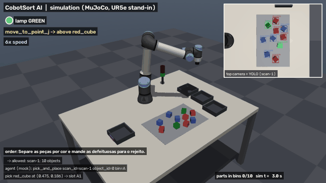
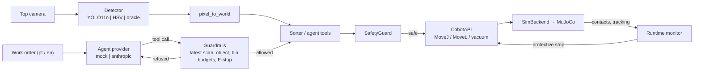

# CobotSort AI

A simulated collaborative-robot sorting cell: a 6-axis cobot with a vacuum gripper sorts colored cubes
into bins using a YOLO detector trained on synthetic data, a safety layer that blocks unsafe motion, and an
AI operator agent that turns plain-language work orders (Portuguese or English) into safe, validated robot
actions.




> **This is a simulation.** All results below come from MuJoCo. Nothing here was run on a real robot,
> and none of the numbers should be read as real-hardware performance. Full video: [`media/demo.mp4`](media/demo.mp4).

## What it does

- **Sorts parts automatically (module B)**: scan → detect → plan → pick-and-place → re-scan to verify,
  until no sortable part remains; or part by part on the operator's choice (module A, `cobotsort semi`).
- **Detects parts with YOLO11n trained only on synthetic images (module V)**, labeled from segmentation
  renders with domain randomization, and evaluated against a classical HSV baseline.
- **Integrates the detector into the cell (module G)**: detections become world coordinates through a
  pinhole model of the camera and drive the pick-and-place.
- **Blocks unsafe motion before it starts**: joint limits, workspace box, collaborative speed limits,
  manipulability (singularities) and collision replay of the whole trajectory; a runtime monitor stops the
  robot on any unplanned contact; signal tower GREEN / YELLOW / RED with E-stop → reset → engage.
- **Takes work orders in plain language**: an operator agent (mock or Claude) turns "Separe as peças por
  cor" into validated tool calls. The LLM decides *what*; deterministic code decides *how* and *whether*.

## Results

All numbers are produced by commands in this repository; each section names its command.
Judging order of the BRICS Skills Camp tasks: **safety > degree of automation > precision > speed**.

### Benchmark (20 seeds per detector)

`cobotsort benchmark --seeds 20 --detector oracle hsv yolo --provider mock` → [`results/benchmark.md`](results/benchmark.md)

| Detector | Unplanned contacts | Protective stops | Adversarial blocked | Cubes sorted w/o operator (%) | Episodes end to end (%) | Placement error mean (mm) | Placement error p95 (mm) | Wrong-bin rate (%) | Perception loc. error (mm) | Sim s / cube | Sim s / episode |
|---|---|---|---|---|---|---|---|---|---|---|---|
| oracle | 0 | 0 | 10/10 | 97.2 | 80 | 0.08 | 0.18 | 0.0 | 0.00 | 24.0 | 205.4 |
| hsv | 0 | 0 | 10/10 | 97.2 | 80 | 1.30 | 1.90 | 0.0 | 1.27 | 24.0 | 205.4 |
| yolo | 0 | 0 | 10/10 | 97.2 | 80 | 0.91 | 1.29 | 0.0 | 0.91 | 24.0 | 205.4 |

176 cubes per detector. The 2.8 % not sorted are 5 cubes in 4 episodes whose class had more parts than its
bin has slots (4): the full bin refuses the move and the part is flagged for the operator, which is also why
only 80 % of the episodes end with every cube in its bin. Wall-clock time is 8.2–8.6 s per episode on the
author's CPU (see the benchmark file). The oracle detector reads the simulator and is the upper bound.

### Perception

`cobotsort eval-vision` (after `cobotsort dataset` and `cobotsort train`) → [`results/perception.md`](results/perception.md)

| Detector | Set | Precision | Recall | mAP@50 | mAP@50-95 | CPU ms / frame | Localization error mean / p95 (mm) |
|---|---|---|---|---|---|---|---|
| HSV | synthetic test (120 images) | 1.000 | 0.977 | 0.992 | — | 2.1 | 1.64 / 3.93 |
| HSV | hard lighting (150 images) | 0.989 | 0.927 | 0.942 | — | 2.1 | 1.97 / 5.42 |
| YOLO11n | synthetic test (120 images) | 1.000 | 0.998 | 1.000 | 0.986 | 22.1 | 1.45 / 1.65 |
| YOLO11n | hard lighting (150 images) | 0.989 | 0.978 | 0.991 | 0.950 | 21.8 | 1.38 / 2.37 |

Precision and recall at the cell's operating point (confidence ≥ 0.6, IoU ≥ 0.5). The hard set uses
stronger and colored lighting that the training set never had. Training curves (no sign of overfitting:
validation loss falls with training loss) are in [`results/yolo_training_curves.png`](results/yolo_training_curves.png),
confusion matrices in [`results/confusion_matrix.png`](results/confusion_matrix.png).
The cubes are small in the image (about 25–30 px across); small objects are a known weakness of one-stage
detectors, and a two-stage detector (e.g. Faster R-CNN) is a planned comparison.

### Operator agent

`cobotsort agent-eval` → [`results/agent_eval.md`](results/agent_eval.md)

10 work orders (5 Portuguese, 5 English) with expected end states checked against the simulator: sort
everything, only one color to a given bin, an order naming a bin that does not exist (must refuse), two
ambiguous orders (must ask), "pare" in the middle of a task (must stop), and a bin that fills up.

| Provider | Task success |
|---|---|
| mock (deterministic keyword planner) | 10/10 |
| anthropic | not evaluated: no API key was available when the results were generated |

### Demo run

`cobotsort record --seed 7 --detector yolo --order "Separe as peças por cor e mande as defeituosas para o rejeito." --out media/demo.mp4`
→ [`results/demo_run.json`](results/demo_run.json): 10/10 parts in the correct bin, 0 unplanned contacts,
11 agent tool calls. The video compresses simulated time: transfers at 6×, approaches at 3×, labeled on screen.

### Kinematics

`cobotsort kinematics-report` → [`results/kinematics.md`](results/kinematics.md) and
`cobotsort calibrate-manip --seeds 5` → [`results/manipulability.md`](results/manipulability.md)

- DH forward kinematics with the link offsets of the simulated model matches MuJoCo to numerical precision;
  the official UR5e DH table differs by 1.12 mm at most (the Menagerie model rounds a few offsets).
- Damped least-squares IK solves 100/100 reachable targets with a maximum error of 0.0098 mm, and finds
  between 2 and 10 distinct joint solutions per target.
- Manipulability thresholds come from normal operation: warn below 0.0405 (5th percentile), block below
  0.0157 (half the minimum observed).

## Architecture



**Safety-first design: the LLM decides *what*, deterministic code decides *how* and *whether*.** The agent
can only call `scan_workspace`, `get_cell_status`, `pick_and_place(scan_id, object_id, bin)` and `stop_cell`.
It cannot change speeds, limits or coordinates. Guardrails in code reject stale scan ids, unknown objects,
low-confidence detections, unknown or full bins and exhausted budgets, and every motion of every mode still
passes the SafetyGuard. A stop from the operator is executed by code before the model gets another turn.
More in [`docs/architecture.md`](docs/architecture.md); every deviation from the build spec is in
[`docs/decisions.md`](docs/decisions.md).

## Skills Camp topics → where they live in the code

| Topic | File |
|---|---|
| DoF, serial manipulator, FK with DH parameters | [`kinematics/dh.py`](cobotsort/kinematics/dh.py) |
| IK (many or no solutions) | [`kinematics/ik.py`](cobotsort/kinematics/ik.py) |
| Singularities and manipulability | [`kinematics/manipulability.py`](cobotsort/kinematics/manipulability.py), [`safety/guard.py`](cobotsort/safety/guard.py) |
| Dynamics τ = M(q)q̈ + C(q,q̇)q̇ + G(q) | `cobotsort diag` ([`cli.py`](cobotsort/cli.py)) |
| Cobot safety, E-stop, signal lamp, reduced speed | [`safety/`](cobotsort/safety) |
| MoveJ vs MoveL and the pick-and-place sequence | [`motion/`](cobotsort/motion), [`robot/api.py`](cobotsort/robot/api.py) |
| OOP: `abc.ABC`, dataclasses, exceptions | [`robot/backend.py`](cobotsort/robot/backend.py), [`perception/detector.py`](cobotsort/perception/detector.py) |
| Threads, the GIL and Lock | `gui/app.py` (milestone M7, not built yet) |
| Git flow | branches `feat/mX-*`, `--no-ff` merges, tags `v0.0`…`v0.6` |
| HSV, morphology, contours | [`perception/hsv.py`](cobotsort/perception/hsv.py) |
| CNN/YOLO, labeling, train/val/test, augmentation, overfitting, precision/recall/mAP | [`perception/`](cobotsort/perception) |
| Modules A, B, V, G | `cobotsort semi`, `cobotsort auto`, `cobotsort dataset / train / eval-vision`, `cobotsort auto --detector yolo` |
| Criteria order | [`metrics/benchmark.py`](cobotsort/metrics/benchmark.py) |

## Why I built this

In September 2026 I took part in the BRICS Hi-Tech Skills Camp for the skill *Development and
Implementation of Industrial AI Solutions*, where we programmed a collaborative robot, trained object
detectors and were judged on safety, automation, precision and speed, in that order. I rebuilt the four
competition modules in simulation to practice them end to end and to keep a record of what I learned. The
operator agent reuses the pattern I designed as team lead and tech lead of EduBot (HACKaSTONE 2026 Grand
Finalist, and the subject of a lead-author paper accepted at the Conference AI for Education The Netherlands
2026): a model that only chooses deterministic tools, guardrails enforced by code, an interchangeable
`mock` / `anthropic` provider layer and a rule-based fallback. The vision side follows my work on Leak Track
(IEEE RAS), an inspection robot running CNNs on FLIR thermal images with ROS 2 and OpenCV, and the optional
SLURM job comes from my HPC internship at SENAI CIMATEC, where I train deep learning models on a GPU cluster.

## How to run

Requirements: Python 3.11 or 3.12, git, about 4 GB of disk (PyTorch comes with Ultralytics). A GPU is
optional; everything runs on the CPU.

```bash
python -m venv .venv
source .venv/bin/activate          # Windows: .venv\Scripts\activate
pip install -e ".[dev]"
python scripts/fetch_assets.py     # sparse-clones the UR5e from MuJoCo Menagerie into third_party/
cobotsort selfcheck --reach        # loads the scene, checks reachability, saves media/selfcheck.png
```

Run the demo and the cell:

```bash
cobotsort record --seed 7 --detector yolo --order "Separe as peças por cor e mande as defeituosas para o rejeito." --out media/demo.mp4
cobotsort auto --detector yolo --seed 1        # module B: fully automatic sorting
cobotsort semi --seed 3                        # module A: operator picks part and bin
cobotsort agent "Only the red ones to bin B."  # natural-language order (mock provider by default)
cobotsort diag                                 # gravity and Coriolis torques at home
```

Train and evaluate the detector (module V):

```bash
cobotsort dataset            # 800 images (70/15/15) + 150 hard images, YOLO format, in data/
cobotsort train              # YOLO11n, 640 px, 40 epochs (GPU if available); --quick for CPU
cobotsort eval-vision        # results/perception.md and results/confusion_matrix.png
```

Reproduce every result file: `cobotsort benchmark --seeds 20 --detector oracle hsv yolo --provider mock`,
`cobotsort agent-eval`, `cobotsort kinematics-report`, `cobotsort calibrate-manip --seeds 5`, and `pytest`.

Notes:
- Headless Linux: set `MUJOCO_GL=egl` (or `osmesa`).
- Claude as the operator: copy `.env.example` to `.env`, set `ANTHROPIC_API_KEY` and
  `COBOTSORT_PROVIDER=anthropic` (model `claude-sonnet-5-5` by default, `COBOTSORT_MODEL` to change it).
  Without a key, or on any API error, the agent falls back to the rule-based planner and logs why.
- Every agent run writes an audit log to `logs/agent_<timestamp>.jsonl`.
- `scripts/train.slurm` trains on a SLURM GPU cluster; use it only on a cluster you are allowed to use.

## Honest limitations

- **Simulation only.** No result here comes from real hardware.
- **The UR5e stands in for the ARM95** used at the camp (same class: 6 axes, 5 kg payload), whose model
  is not public. `robot/arm95_stub.py` only documents how a real backend would plug in.
- **Synthetic data leaves a sim-to-real gap**: rendered lighting, flat colors and a noise-free camera. The
  HSV baseline does well here partly because the colors are clean; real parts and light would be harder.
- **The vacuum is idealized**: a part within 8 mm of the cup tip is rigidly attached (no seal, airflow or slip).
- The bins are outside the top camera's view, so "the part is in the expected bin" is verified with a
  simulated bin presence sensor; "the part left the pick area" is verified by the detector.
- The Claude provider was not evaluated with a live key in this build; its tool loop is covered by tests
  with a fake client.
- Collaborative speed limits make the cycle slow: 24 s of simulated time per cube.

## Next steps

- A ROS 2 bridge (`/joint_states`, `/detections`).
- A real `Arm95Backend`.
- Faster R-CNN vs YOLO on small objects.
- A thermal camera channel in the style of Leak Track.
- The PyQt6 GUI (milestone M7): manual jog, semi-auto, auto and agent tabs with an E-stop button.

## Credits and licenses

- **MuJoCo** (Google DeepMind), Apache-2.0.
- **MuJoCo Menagerie, Universal Robots UR5e model**: "This model is released under a BSD-3-Clause
  License." Copyright 2018 ROS Industrial Consortium. It is derived from the publicly available URDF
  description of the UR5e by Universal Robots. The model is downloaded by `scripts/fetch_assets.py` into
  `third_party/` and is not redistributed in this repository.
- **Ultralytics YOLO11**, AGPL-3.0. This project trains and runs Ultralytics models and ships a fine-tuned
  checkpoint (`models/cobotsort_yolo11n.pt`), so it is distributed under AGPL-3.0 as well
  (`pyproject.toml`): if you modify it and offer it to others, including over a network, you must share
  your source under the same license. Closed-source use would need an Ultralytics Enterprise License.
- Also used: PyTorch, OpenCV, NumPy, SciPy, imageio/FFmpeg, the Anthropic Python SDK, matplotlib.

Author: Victor Barreto Andrade Gonçalves, Computer Engineering, SENAI CIMATEC University (Salvador, Brazil).
