# Architecture

CobotSort AI is a simulated sorting cell. Everything below runs in MuJoCo; nothing talks to real
hardware.

## Data flow

```mermaid
flowchart LR
    order["Work order<br/>(Portuguese / English)"] --> agent
    subgraph agentbox["Operator agent (EduBot pattern)"]
        agent["Provider<br/>mock | anthropic"] -->|tool call| rails["Guardrails<br/>scan id, object id, bin,<br/>budgets, E-stop"]
        rails -->|refused: is_error| agent
    end
    cam["top camera<br/>640x480"] --> det["Detector<br/>YOLO11n | HSV | oracle"]
    det --> p2w["camera.pixel_to_world"]
    p2w --> cell["Sorter / agent tools<br/>rules, slots, verify"]
    rails -->|allowed| cell
    cell --> guard["SafetyGuard<br/>limits, workspace, speed,<br/>manipulability, collisions"]
    guard -->|planned trajectory OK| api["CobotAPI<br/>MoveJ / MoveL / vacuum"]
    guard -.->|refused| cell
    api --> backend["SimBackend"]
    backend --> mj["MuJoCo<br/>UR5e + suction cup"]
    mj -->|contacts, tracking error| monitor["Runtime monitor"]
    monitor -->|protective stop| api
    api --> lamp["Signal lamp<br/>GREEN / YELLOW / RED"]
```

`top camera → Detector → camera.pixel_to_world → Sorter / Agent tools → SafetyGuard → CobotAPI →
SimBackend → MuJoCo`

## Safety first: who decides what

| Layer | Decides | Can it be bypassed by the language model? |
|---|---|---|
| Provider (mock or Claude) | *What* to do: which tool, which part, which bin | — |
| Guardrails (`agent/guardrails.py`) | *Whether* the request is valid now: latest scan, existing object with confidence ≥ 0.6, existing bin with a free slot, 20 tool calls / 12 picks per order, E-stop | No: plain code, independent of the prompt |
| SafetyGuard (`safety/guard.py`) | *Whether* the motion is safe: joint limits, workspace box, speed limits, manipulability, collision replay; runtime contact monitor | No: every motion of every mode (auto, semi-auto, agent) goes through it |
| CobotAPI (`robot/api.py`) | *How*: IK, MoveJ / MoveL, engage / E-stop / reset state machine | No |

The language model never sees coordinates it could change, speeds or limits: its only actions are
`scan_workspace`, `get_cell_status`, `pick_and_place(scan_id, object_id, bin)` and `stop_cell`.

## Modules

| Path | Role |
|---|---|
| `sim/scene.py`, `sim/world.py`, `sim/render.py` | MjSpec scene, episode reset, stepping, kinematic vacuum attach, rendering |
| `kinematics/dh.py`, `ik.py`, `manipulability.py` | DH forward kinematics, DLS inverse kinematics, Yoshikawa index |
| `motion/trajectory.py` | Synchronized quintic MoveJ, Cartesian MoveL with slerp and wrist-flip detection |
| `robot/backend.py`, `sim_backend.py`, `arm95_stub.py`, `api.py` | Hardware abstraction, MuJoCo backend, ARM95 placeholder, command set |
| `safety/guard.py`, `lamp.py`, `adversarial.py` | Pre-motion checks, runtime monitor, signal tower, the 10 unsafe requests |
| `perception/` | Camera model, Detection/Detector, HSV, YOLO, oracle, dataset, training, evaluation |
| `cell/` | Rules, slots, automatic and semi-automatic cycles, reachability self-check |
| `agent/` | Tools, guardrails, prompt, providers, operator loop, evaluation |
| `metrics/` | Benchmark and demo recorder |
| `gui/app.py` | PyQt6 operator GUI: worker `QThread` for the simulation, `MjData` under a lock, rendering in the GUI thread |
